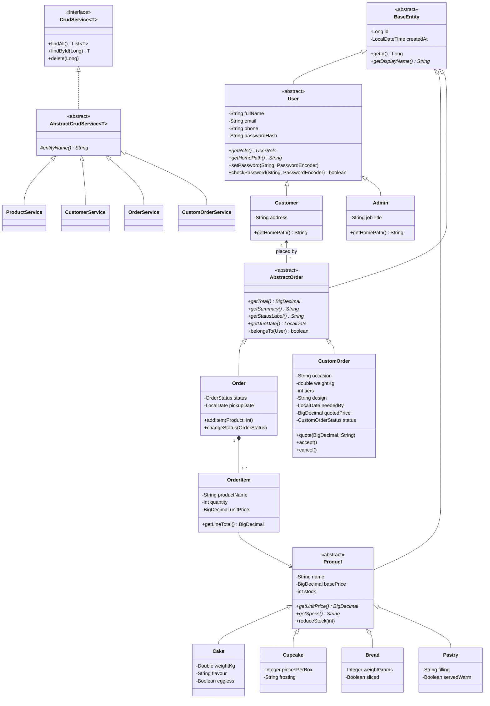

# SprinkleUp Bakery

A web system for **Sprinkle up by Aish**. Customers browse the menu, place pickup orders and request custom cakes; bakery staff manage products, customers, orders and custom cake quotes from an admin area.

**Stack:** Java 21, Spring Boot 3.5, JSP + JSTL, Bootstrap 5, MySQL 8 (Spring Data JPA / Hibernate), BCrypt password hashing.

## Running it

1. Make sure MySQL is running on `localhost:3306`. The `sprinkleup_db` database is created automatically.
2. Open the folder in IntelliJ IDEA (it is a Maven project).
3. In **Run > Edit Configurations**, add the environment variables `DB_USERNAME=root;DB_PASSWORD=<your MySQL password>`.
4. Run `SprinkleUpApplication` and open <http://localhost:8080>.

On first start a sample menu (10 products) and two accounts are added.

### Starter accounts

| Role | Email | Password |
|---|---|---|
| Bakery staff (admin) | `admin@sprinkleup.lk` | `Admin@123` |
| Demo customer | `nethmi@example.com` | `Customer@123` |

These come from `application.properties`. Change them before showing the site to anyone else (set `ADMIN_PASSWORD` / `DEMO_PASSWORD` as environment variables).

### Pages

| Who | Page | URL |
|---|---|---|
| Everyone | Menu | `/` |
| Everyone | Order from the menu (guest or signed in) | `/order` |
| Everyone | Sign in / create account | `/login`, `/register` |
| Customer | My orders and custom cakes | `/account` |
| Customer | My details and password | `/account/edit` |
| Customer | Request a custom cake | `/custom-orders/new` |
| Staff | Dashboard | `/admin` |
| Staff | Products, customers, orders | `/admin/products`, `/admin/customers`, `/admin/orders` |
| Staff | Custom cake requests and quotes | `/admin/custom-orders` |

Signed-out visitors who open a customer or staff page are sent to the sign-in page and brought back afterwards. Customers who open a staff page get a "Staff only" page. A customer can only see their own orders.

## CRUD operations

| Entity | Create | Read | Update | Delete |
|---|---|---|---|---|
| Product | Add a cake, cupcake, bread or pastry | Menu, admin list with search and type filter | Edit details, price, stock, visibility | Remove (old orders keep a copy of the name and price) |
| Customer | Sign up, admin form, or automatically when a guest orders | Admin list with search, own account page | Edit details (admin or the customer), change password | Delete (blocked if they have orders) |
| Order | Shop order page, admin "new order" page | Admin list with status filter, detail page, customer's own history | Change status, pickup date, notes | Delete (stock is returned if the order was still open) |
| Custom cake request | Customer request form | Customer's own page, admin list with status filter | Customer edits until quoted; staff send a quote and move the status; customer accepts | Customer cancels; staff delete |

### Custom cake flow

`Awaiting quote` → (staff send a price) → `Quote ready` → (customer accepts) → `Accepted` → `Being made` → `Completed`.
The customer can cancel until the cake is being made, and staff can decline. A request needs at least 3 days' notice, can only be edited before it is quoted, and cannot move to Accepted or later without a price.

## How the OOP concepts are applied

| Concept | Where |
|---|---|
| **Abstraction** | Abstract classes `BaseEntity`, `User`, `Product` and `AbstractOrder` describe what every subclass must provide; `CrudService<T>` is an interface the controllers depend on. |
| **Inheritance** | `Customer` and `Admin` extend `User`; `Cake`, `Cupcake`, `Bread`, `Pastry` extend `Product`; `Order` and `CustomOrder` extend `AbstractOrder`; all of these extend `BaseEntity`. All services extend `AbstractCrudService`. |
| **Polymorphism** | Each product type overrides `getUnitPrice()` (cake by weight, cupcakes per box, sliced bread adds a charge). `Order` and `CustomOrder` each override `getTotal()`, `getSummary()`, `getStatusLabel()` and `getDueDate()`, so the account page shows both in one list. `Admin` and `Customer` override `getHomePath()` to decide where they land after signing in. Services override `delete()` with their own rules. |
| **Encapsulation** | All fields are `private`. Setters validate values (no negative price or stock, emails in lower case). Stock only changes through `reduceStock()` / `restock()`. A custom cake only changes stage through `quote()`, `accept()`, `cancel()` and `changeStatus()`, which refuse steps that don't make sense. |
| **Information hiding** | `User` stores only a BCrypt hash of the password and has no getter for it; other classes can only call `checkPassword()`. `BaseEntity` has no `setId()`. `Order.getItems()` returns a read-only list, so items can only be added through `addItem()`. The `OrderItem` constructor is package-private. |

## Class diagram

The PlantUML source is in [`docs/class-diagram.puml`](docs/class-diagram.puml) (paste it into <https://www.plantuml.com/plantuml> to get an image). The same diagram in Mermaid, which GitHub draws automatically:



## Project layout

```
src/main/java/com/sprinkleup
├── model        BaseEntity; User → Customer, Admin; Product → Cake, Cupcake, Bread, Pastry;
│                AbstractOrder → Order, CustomOrder; OrderItem; enums
├── dto          form objects: ProductForm, OrderForm, CustomOrderForm, RegisterForm, ProfileForm
├── repository   Spring Data JPA interfaces
├── service      CrudService, AbstractCrudService, Product/Customer/Order/CustomOrder/Auth services
├── controller   shop, auth, account, custom orders, admin controllers
├── exception    NotFoundException, ForbiddenException
└── config       AuthInterceptor (who is signed in, page access), WebConfig, DataSeeder
src/main/webapp/WEB-INF/views   JSP pages
src/main/resources/static       CSS, JavaScript and the logo
```
