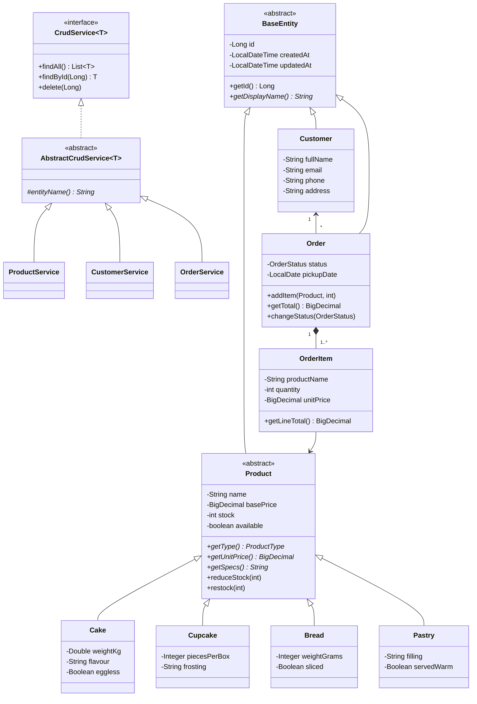

# SprinkleUp Bakery

A web system for the SprinkleUp bakery. Customers browse the menu and place pickup orders; bakery staff manage products, customers and orders from an admin area.

**Stack:** Java 21, Spring Boot 3.5, JSP + JSTL, Bootstrap 5, MySQL 8 (Spring Data JPA / Hibernate).

## Running it

1. Make sure MySQL is running on `localhost:3306`. The `sprinkleup_db` database is created automatically.
2. Open the folder in IntelliJ IDEA (it is a Maven project).
3. In **Run > Edit Configurations**, add the environment variables `DB_USERNAME=root;DB_PASSWORD=<your MySQL password>`.
4. Run `SprinkleUpApplication` and open <http://localhost:8080>.

On first start a sample menu (10 products) and one demo customer are added.

| Page | URL |
|---|---|
| Shop menu | `/` |
| Place an order | `/order` |
| Admin dashboard | `/admin` |
| Products | `/admin/products` |
| Customers | `/admin/customers` |
| Orders | `/admin/orders` |

## CRUD operations

| Entity | Create | Read | Update | Delete |
|---|---|---|---|---|
| Product | Add a cake, cupcake, bread or pastry | Menu, admin list with search and type filter | Edit details, price, stock, visibility | Remove (old orders keep a copy of the name and price) |
| Customer | Admin form, or automatically when someone orders from the shop | List with search | Edit details | Delete (blocked if they have orders) |
| Order | Shop order page, admin "new order" page | List with status filter, order detail page | Change status, pickup date, notes | Delete (stock is returned if the order was still open) |

## How the OOP concepts are applied

| Concept | Where |
|---|---|
| **Abstraction** | `Product` and `BaseEntity` are abstract classes; `CrudService<T>` is an interface that the controllers depend on. |
| **Inheritance** | `Cake`, `Cupcake`, `Bread`, `Pastry` extend `Product`; `Product`, `Customer`, `Order` extend `BaseEntity`; all services extend `AbstractCrudService`. |
| **Polymorphism** | Each product type overrides `getUnitPrice()` (cake priced by weight, cupcakes per box, sliced bread adds a charge), `getSpecs()`, `applySpecs()` and `fillSpecs()`. The menu and orders treat every item as a `Product`. Services override `delete()` with their own rules. |
| **Encapsulation** | All fields are `private`. Setters validate values (no negative price or stock, emails stored in lower case). Stock only changes through `reduceStock()` / `restock()`. |
| **Information hiding** | `BaseEntity` has no `setId()`. `Order.getItems()` returns a read-only list, so items can only be added through `addItem()`, which also takes them out of stock. The `OrderItem` constructor is package-private. |

## Class diagram

The PlantUML source is in [`docs/class-diagram.puml`](docs/class-diagram.puml). The same diagram in Mermaid (GitHub draws this automatically):



## Project layout

```
src/main/java/com/sprinkleup
├── model        entities: BaseEntity, Product (+4 subclasses), Customer, Order, OrderItem, enums
├── dto          form objects: ProductForm, OrderForm
├── repository   Spring Data JPA interfaces
├── service      CrudService, AbstractCrudService, Product/Customer/OrderService
├── controller   Shop, Dashboard, Product, Customer, Order controllers
└── config       DataSeeder (sample data)
src/main/webapp/WEB-INF/views   JSP pages
src/main/resources/static       CSS and JavaScript
```
